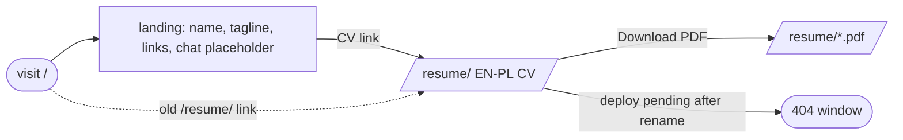

## Brainstorm

Repo becomes user site `https://niconisoria.github.io/`. Root `/` 404s today; CV lives at `/resume/` via `base: "/resume"`.

Scope: drop `base`, move CV pages under `src/pages/resume/`, PDFs under `public/resume/`, fix all base-path refs, point `generate-pdf.sh` at new paths. New minimal EN-only landing at `/`: name, tagline (reuse `subtitle`), links (CV, GitHub, LinkedIn, booking from `resume.en.ts`), empty placeholder section for future chat widget. Then rename repo to `niconisoria.github.io`.

Constraints: public URLs unchanged — `/resume/`, `/resume/ats`, all 4 PDFs. PDF filenames unchanged. Reuse Layout + design system, no cards/extras. No chat widget, no `/insights`. No `../resume-agent` changes. Brief `/resume/` 404 window between rename and deploy acceptable.

Related: [PDF export](20260916234901_pdf_export.md), [ATS resume path](20260918150158_ats_resume_path.md), [CV language switch](20260926194513_cv_language_switch.md)

## Story

As visitor, want landing at site root, so find CV and contact links fast.

AC:

1. `/` shows name, tagline, links to CV, GitHub, LinkedIn, booking
2. `/` has empty placeholder section for future chat
3. CV link opens `/resume/`
4. `/resume/` and `/resume/ats` show CV same as before
5. all 4 PDFs download from same `/resume/*.pdf` URLs as before
6. EN/PL toggle and `?lang=` still work on `/resume/`
7. live site serves `/` from `https://niconisoria.github.io/` after repo rename

## Design

### Flow

### Data

input: `resumeData` (`src/data/resume.en.ts`) — `name`, `subtitle`, `links` (LinkedIn, GitHub, booking)
output: static routes `/`, `/resume/`, `/resume/ats`, `/resume/nicolas-nisoria{,-pl,-ats,-ats-pl}.pdf`

### Modules

- `astro.config.mjs` — drop `base: "/resume"`
- `src/lib/base.ts` — delete; root base makes `withBase()` a no-op, callers hardcode absolute paths
- `src/layouts/Layout.astro` — favicon hrefs `/favicon.*`; `langToggle` prop (default true) so EN-only landing hides LangToggle
- `src/components/Header.astro` — name link → `/resume/`
- `src/pages/index.astro` — NEW landing (Layout, design-system tokens, `<section id="chat">` empty placeholder)
- `src/pages/resume/index.astro` — moved from `src/pages/index.astro`, PDF hrefs `/resume/…`
- `src/pages/resume/ats.astro` — moved from `src/pages/ats.astro`, PDF hrefs `/resume/…`
- `public/resume/*.pdf` — moved from `public/*.pdf`, regenerated
- `scripts/generate-pdf.sh` — URL `http://localhost:$PORT/resume/` stays, outputs → `public/resume/`
- `scripts/print-pdf.mjs` — default out → `public/resume/nicolas-nisoria.pdf`
- `README.md` — live URL + pdf path
- `docs/MEMORY.md` — drop `withBase()` note
- `test/pages/landing.test.ts` — NEW: name, tagline, CV/GitHub/LinkedIn/booking links, chat placeholder
- `test/pages/resume/index.test.ts`, `test/pages/resume/ats.test.ts` — moved; PDF hrefs assert `/resume/` prefix

[astro.config.mjs](astro.config.mjs) [index.astro](src/pages/index.astro) [resume/index.astro](src/pages/resume/index.astro) [resume/ats.astro](src/pages/resume/ats.astro) [Layout.astro](src/layouts/Layout.astro) [Header.astro](src/components/Header.astro) [base.ts (deleted)](src/lib/base.ts) [generate-pdf.sh](scripts/generate-pdf.sh) [print-pdf.mjs](scripts/print-pdf.mjs) [public/resume/](public/resume/) [README.md](README.md) [MEMORY.md](docs/MEMORY.md) [AGENTS.md](AGENTS.md) [landing.test.ts](test/pages/landing.test.ts) [resume/index.test.ts](test/pages/resume/index.test.ts) [resume/ats.test.ts](test/pages/resume/ats.test.ts)

## Summary

Site base now root; CV pages under `src/pages/resume/`, PDFs under `public/resume/`, so public `/resume/*` URLs unchanged. New EN-only landing at `/` reuses `Header` with CV + LinkedIn/GitHub/booking links, empty `#chat` section for future widget. `withBase()` deleted — root base made it no-op; paths hardcoded. Layout `langToggle` prop hides toggle on landing.
