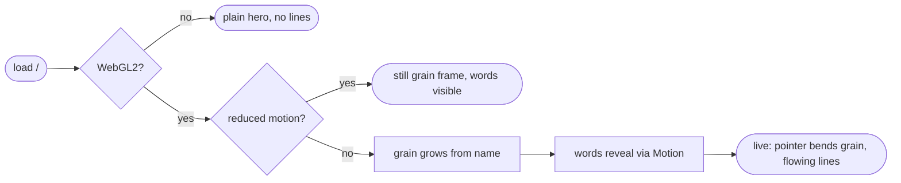

## Brainstorm

Landing at `/` works but flat — no first impression. Want bold look from guitar blue-ash grain (LinkedIn banner), CV stays plain.

Scope: option C layout — centered tagline, name, amber line, summary line, View CV + GitHub/LinkedIn/Book a call pills, empty `#chat` below, theme toggle top-right, no monogram. Animated wood-grain shader patch around name only: crisp flowing lines + knot, light-blue center → sapphire rim → plain dark/light page. Cursor bends grain, link hover ripples grain, load-in grain grows from name then name reveals by word.

Constraints: landing-only layout (phone-width viewport); CV, `/resume/ats`, PDFs untouched. Two new deps max: `@paper-design/shaders`, `motion`, loaded on landing only. Reduced motion → still frame. No WebGL → CSS gradient fallback. Text AA contrast. Built on branch, reviewed locally before merge.

Related: [User site root migration](20261022002808_user_site_root_migration.md), [Dark mode toggle](20260916212748_dark_mode_toggle.md)

## Story

As visitor, want striking landing, so remember Nicolas and click through to CV.

AC:

1. `/` shows title, name, one-liner tagline, View CV + GitHub + LinkedIn + Book a call links, empty chat section
2. no monogram; theme toggle top-right switches dark/light, choice persists
3. seven animated wavy grain lines (alternating blue + wood, evenly spaced, no fill) across top of page behind title + name; tagline, links, chat below
4. grain lines bend near cursor
5. on load grain grows from name, then name appears word by word
6. reduced-motion visitor sees still grain, no load-in
7. no-WebGL visitor sees plain hero without lines, page fully usable
8. text readable (AA contrast) in both themes, layout works at phone width
9. `/resume/`, `/resume/ats`, PDFs unchanged, except: back-to-home button (screen only) and header name links to `/`

## Design

### Flow

### Data

input: `resumeData` (`resume.en.ts`) — `name`, `subtitle`, `headerLinks` (minus email); summary line literal in page
shader uniforms: `{ u_time, u_resolution, u_pixelRatio, u_pointer: vec2, u_reveal: float }`
output: `<canvas>` inside `[data-grain]` hero; `data-grain-state="fallback" | "still" | "live"` on hero

### Modules

- `package.json` — add `@paper-design/shaders`, `motion`
- `src/components/ThemeScript.astro` — NEW: inline theme init (moved out of `Layout.astro`)
- `src/layouts/Layout.astro` — use `ThemeScript`; drop `langToggle` prop (landing no longer uses it)
- `src/layouts/LandingLayout.astro` — NEW: `width=device-width` viewport, favicons, Fraunces, `ThemeScript`, `ThemeToggle`, full-bleed body
- `src/components/GrainHero.astro` — NEW: full-width hero (plain = fallback), slot for tagline + name; client script mounts `ShaderMount`, wires pointer/reveal, reduced-motion + WebGL-failure paths
- `src/components/grain.frag.glsl` — NEW: blue-ash grain fragment shader (7 wavy string lines, alternating blue/wood, transparent ground, pointer bend, reveal mask); imported `?raw`
- `src/pages/index.astro` — option C markup; name split into word spans at build time
- `test/pages/landing.test.ts` — tagline, name words, summary, 4 links (CV `/resume/`), empty `#chat`, no monogram, no lang toggle, grain hero holds tagline + name, summary outside, device-width viewport
- `test/pages/resume/index.test.ts` — existing; still asserts lang toggle (Layout change guard)

[package.json](package.json) [index.astro](src/pages/index.astro) [GrainHero.astro](src/components/GrainHero.astro) [grain.frag.glsl](src/components/grain.frag.glsl) [LandingLayout.astro](src/layouts/LandingLayout.astro) [ThemeScript.astro](src/components/ThemeScript.astro) [Layout.astro](src/layouts/Layout.astro) [Header.astro](src/components/Header.astro) [ThemeToggle.astro](src/components/ThemeToggle.astro) [favicon.svg](public/favicon.svg) [favicon.ico](public/favicon.ico) [public/resume/](public/resume/) [landing.test.ts](test/pages/landing.test.ts) [resume/index.test.ts](test/pages/resume/index.test.ts)

## Summary

Landing hero: seven wavy grain lines (alternating blue/wood, transparent ground) drawn by custom GLSL shader via Paper `ShaderMount`, slowly flowing, bending around cursor, growing from centre on load; name reveals word by word via Motion. Reduced motion → still frame; no WebGL → plain hero. Landing has own phone-width layout; title + name in hero, tagline, links, empty `#chat` below, fits one screen. CV gained back-to-home button + name link to `/`; theme toggle double-icon bug fixed; favicon now line tile.
