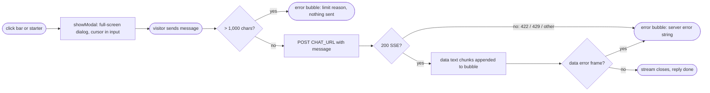

## Brainstorm

Visitors can't ask about Nicolas on site. resume-agent S05: chat on landing, streaming from live Fly `/chat` backend.

Scope: Deep Chat (`deep-chat@2.5.1`, pinned) in landing `#chat` section, reusable component. Landing entry: "Ask about Nicolas…" bar under links; chat opens full screen, closes back to landing. 2–3 clickable starter prompts. One-line privacy notice. Request mapped to `{message}`, 1,000-char client limit. 422/429/stream `error` frames show server's `error` string, never generic text. Backend URL in one place (`PUBLIC_CHAT_URL`). Matches design system, both themes.

Constraints: backend unchanged (`../resume-agent` untouched); CORS allows only `https://niconisoria.github.io`, so local runs need mock `/chat`. No citations, cards, feedback or history UI (S10/S13/S07). `/resume/` link to chat out of scope. Landing may scroll once chat opens.

Related: [Landing grain redesign](20261022011355_landing_grain_redesign.md), [User site root migration](20261022002808_user_site_root_migration.md)

## Story

As visitor, want to ask about Nicolas on landing, so get answers without reading whole CV.

AC:

1. landing shows "Ask about Nicolas…" bar + starters under links, no message area on landing
2. 2–3 starter prompts; click sends that question
3. clicking bar or starter opens chat full screen, cursor in input; reply streams in piece by piece
4. one-line privacy notice always visible in open chat
5. message over 1,000 chars blocked before sending, with reason shown
6. too many messages (429) shows server's "Too many messages… try again in N seconds" text
7. invalid message (422) or mid-reply failure shows server's error text, never generic or raw error
8. widget readable and on-brand in dark and light themes, works at phone width
9. close button or Esc returns to landing; conversation kept on reopen
10. rest of landing (hero, links, animation) unchanged

## Design

### Flow

### Data

request: `POST CHAT_URL` `{ message: string }`, `Content-Type: application/json`
stream: `data: {"text": string}` chunks · `data: {"error": string}` final frame on failure
errors: `422 | 429 | other` → `{ error: string }` (429 adds `Retry-After`)
config: `CHAT_URL = PUBLIC_CHAT_URL ?? (dev server ? mock localhost:8787 : Fly /chat)`, `MAX_CHARS = 1000`

### Modules

- `package.json` — add `deep-chat` pinned `2.5.1`; `mock:chat` script
- `src/lib/chat.ts` — NEW: `CHAT_URL`, `MAX_CHARS`, starter prompts, `chatRequest(details)` for Deep Chat `requestInterceptor`: maps latest `messages[].text` → `{message}`, returns `{error}` (limit reason) when > 1,000 chars. Streaming, SSE parse and server error display stay Deep Chat built-in (`connect: {url, method: "POST", stream: true}` + `errorMessages.displayServiceErrorMessages`; 2.5.1 source shows non-2xx JSON `{error}` bodies and `{error}` SSE frames surface the server string)
- `src/lib/chat.test.ts` — NEW: body mapping, 1,000-char block (limit inclusive), whitespace kept for server validation
- `src/components/ChatWidget.astro` — NEW: `<deep-chat>` with built-in `connect`, `chatRequest` interceptor, `displayServiceErrorMessages`, landing entry = starter buttons + "Ask about Nicolas…" button; Deep Chat lives permanently in native full-screen `<dialog>` (`showModal()`: Esc, focus, inert page, modal semantics native; never moved, so messages survive), close via `<form method="dialog">`, `focusInput()` on open, page scroll locked via CSS `:has(dialog[open])`, theme via `var(--color-…)` style values. Deep Chat loaded on idle (~115KB gz), properties set after element defined. `auxiliaryStyle`: `#container` fills height (else input floats under messages), themed thin scrollbar. Send arrow offset (+5px up, 10px in) to sit centred, clear of the input's rounded end; input radius 21px so wrapped text gets a rounded box, not a blob
- `src/components/ChatWidget.test.ts` — NEW: `deep-chat` inside closed `<dialog>`, open button, privacy notice, 3 starter prompts, close button
- `src/pages/index.astro` — `<ChatWidget />` inside `#chat`
- `test/pages/landing.test.ts` — `#chat` holds widget (no longer empty)
- `scripts/mock-chat.mjs` — NEW: local `/chat` mock (CORS for localhost, SSE chunks, error frame on "fail", 422 on > 1,000, 429 after 10/min)
- `README.md` — `npm run mock:chat` line

[package.json](package.json) [chat.ts](src/lib/chat.ts) [chat.test.ts](src/lib/chat.test.ts) [ChatWidget.astro](src/components/ChatWidget.astro) [ChatWidget.test.ts](src/components/ChatWidget.test.ts) [index.astro](src/pages/index.astro) [landing.test.ts](test/pages/landing.test.ts) [mock-chat.mjs](scripts/mock-chat.mjs) [README.md](README.md)

## Summary

Landing shows starter prompts + "Ask about Nicolas…" bar; clicking either opens Deep Chat 2.5.1 in native full-screen `<dialog>` (Esc, focus, inert page native), closing keeps conversation. Built-in `connect` streams from Fly `/chat`; `chatRequest` sends `{message}` and blocks > 1,000 chars; `displayServiceErrorMessages` shows server `error` strings (422, 429, stream frames). Deep Chat loads on idle (~115KB gz), shows "couldn't load" message on failure; theme via CSS variables into its shadow DOM. Dev server talks to `npm run mock:chat`.
