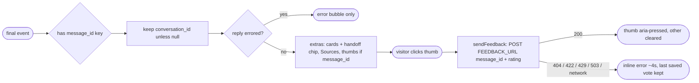

## Brainstorm

Backend M3 (resume-agent S11/S13/S14) adds answer feedback, human handoff tickets, daily budget fallback; widget shows none. resume-agent M3 widget handoff.

Scope: 👍/👎 under answers with `message_id` (`POST /feedback`, rating `1` / `-1`; re-vote replaces), selected state visible, other thumb switches; error text inline next to thumbs, fades, vote reverts to last saved. `handoff` card (`label`, `issue` number, no url) as non-clickable chip "✓ label · ticket #N". Budget fallback (text + booking/CV cards, `message_id` and maybe `conversation_id` null) renders as normal answer, no thumbs, stored conversation kept. Privacy notice → "Messages are processed by AI. Emails you share are used only so Nicolas can reply." Mock follows new contract.

Constraints: `../resume-agent` untouched (read for contract only). Backend M3 not deployed yet. Final event may carry `conversation_id: null`. No /insights page.

Related: [Widget citations and cards](20261023190405_widget_citations_cards.md), [Landing chat widget](20261022210345_landing_chat_widget.md)

## Story

As visitor, want to rate answers, see handoff confirmed and get help when assistant rests, so Nicolas improves answers and I still reach him.

AC:

1. 👍/👎 under each saved answer; click saves vote, selected thumb visibly marked
2. clicking other thumb switches vote
3. no thumbs on failed replies or "resting" replies
4. vote error shows server's message next to thumbs briefly; thumbs stay usable, show last saved vote
5. handoff confirmation shows as non-clickable chip with label and ticket number
6. "resting for today" reply shows its text plus booking and CV buttons
7. after "resting" reply, follow-ups continue same conversation (or start fresh if none yet)
8. privacy notice says messages processed by AI and shared emails used only so Nicolas can reply
9. thumbs and chip readable in dark and light themes, at phone width

## Design

### Flow

### Data

final event: `{ conversation_id: string | null, message_id: string | null, citations, cards }`, cards add `{ type: "handoff", label: string, issue: number }`
feedback request: `POST FEEDBACK_URL` `{ message_id: string, rating: 1 | -1 }`
feedback response: `200 { status: "saved" }` · `404 | 422 | 429 | 503 { error: string }`
`sendFeedback()` → `{ ok: true } | { error: string }` (network / non-JSON → "Couldn't save your vote. Please try again.")
config: `FEEDBACK_URL = CHAT_URL` with `/chat` → `/feedback`

### Modules

- `src/lib/chat.ts` — final event detected by `"message_id" in event` (id may be null); `conversationId` replaced only by non-null id. `extrasHtml` gets `messageId`: `handoff` card → `✓ label · ticket #N` (ticket part only when `issue` integer) inside `.chat-cards`; thumbs `
` with two `<button data-rating aria-pressed="false" aria-label>` + `` when `messageId` non-null. NEW `FEEDBACK_URL`, `sendFeedback(messageId, rating)`
- `src/lib/chat.test.ts` — null id final event keeps stored id and still yields extras; budget fallback (null message_id, cards) → cards, no thumbs; thumbs carry escaped message id; handoff chip text, no link, ticket omitted when issue missing; `sendFeedback` posts body, maps 200 / `{error}` / network failure (stubbed `fetch`); `FEEDBACK_URL`
- `src/components/ChatWidget.astro` — one `click` listener on `chat.shadowRoot` (delegation; html bubbles live in shadow DOM): `[data-rating]` → `sendFeedback` → set `aria-pressed` on success, else error text in sibling status span, cleared after 4s. `auxiliaryStyle`: `.chat-feedback` buttons (pressed = filled `navy-100`, border `navy-700`), `.chat-chip` (non-link pill, muted). Privacy notice text
- `src/components/ChatWidget.test.ts` — new privacy notice text
- `scripts/mock-chat.mjs` — `POST /feedback` (issued ids → 200, unknown → 404 "Answer not found.", bad rating → 422); "email" → handoff card `issue: 42`; "budget" → fallback text, `message_id: null`, `conversation_id` = sent or null, booking + CV cards; "badvote" → reply with unstored `message_id` (exercises 404)

[chat.ts](../../src/lib/chat.ts) [chat.test.ts](../../src/lib/chat.test.ts) [ChatWidget.astro](../../src/components/ChatWidget.astro) [ChatWidget.test.ts](../../src/components/ChatWidget.test.ts) [mock-chat.mjs](../../scripts/mock-chat.mjs)

[chat.ts](src/lib/chat.ts) [chat.test.ts](src/lib/chat.test.ts) [ChatWidget.astro](src/components/ChatWidget.astro) [ChatWidget.test.ts](src/components/ChatWidget.test.ts) [mock-chat.mjs](scripts/mock-chat.mjs)

## Summary

Final event now detected by `message_id` key, so budget fallback (null ids) renders its booking/CV buttons and never wipes stored `conversation_id`. Extras bubble adds handoff chip ("✓ label · ticket #N", no link) and 👍/👎 when `message_id` non-null; delegated click in Deep Chat shadow DOM posts `/feedback`, marks thumb only after save, one request per answer at a time, server error shown inline 4s. Privacy notice mentions AI + email use. Mock covers feedback, handoff, budget; verified headless at phone width, both themes.
