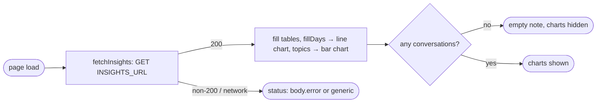

## Brainstorm

resume-agent S19 `insights_page`. Backend `GET /insights` (S18, live) returns 30-day counts: per-day traffic, resolution, feedback, topics, p95 latency, cost per conversation, blocked requests. Site shows them at `/insights`.

Scope: client-side fetch once on load (static site, server caches 5 min, no polling). Chart.js for per-day trend and topics only; everything else plain tables. Non-200 → `body.error` or generic message; network failure → generic. Nulls → "—". Empty window (`days: []`, zero topics) → "No conversations in the last 30 days." instead of empty charts. Counts only, no message text/ids.

Constraints: `../resume-agent` untouched. Live API CORS allows only `https://niconisoria.github.io`, so `astro dev` hits `npm run mock:chat` (new `GET /insights`). Not linked from landing (later, user call).

Related: [Widget feedback and handoff](20261024103725_widget_feedback_handoff.md)

## Story

As visitor, want public `/insights` page, so assistant's numbers easy to read.

AC:

1. `/insights` shows every metric from `GET /insights` as Chart.js charts or tables
2. API error (non-200 or network) shows readable message, not blank page
3. null metrics show "—"; shares %, latency seconds 1 decimal, cost `$0.00046`, "Updated <local time>"
4. per-day chart covers whole 30-day window, gap days 0 (UTC dates)
5. empty window looks intentional: "No conversations in the last 30 days."
6. readable in dark and light themes, at phone width

## Design

### Flow

### Data

response: `{ window_days, generated_at, days: [{date, conversations, messages}], resolution: {conversations, escalated, resolved_share|null}, feedback: {up, down, up_share|null}, topics: [{topic, messages, no_hits}] ×8, p95_latency_ms|null, cost_per_conversation_usd|null, blocked: {rate_limited, budget_exceeded} }`
`fetchInsights()` → `{ data } | { error }`
config: `INSIGHTS_URL = PUBLIC_INSIGHTS_URL ?? CHAT_URL` with `/chat` → `/insights`

### Modules

- `src/lib/insights.ts` — NEW: `INSIGHTS_URL`, `TOPIC_LABELS`, `formatShare`, `formatSeconds`, `formatCost`, `formatUpdated`, `fillDays`, `fetchInsights`
- `src/lib/insights.test.ts` — NEW: formatters incl. null, fillDays gaps/window, fetchInsights 200 / `{error}` / non-JSON / network
- `src/pages/insights.astro` — NEW: LandingLayout, summary + topic tables, two canvases, status line; client script fills DOM, Chart.js (`chart.js/auto`, lazy import), recolors on theme change
- `test/pages/insights.test.ts` — NEW: renders headings, loading status, canvases with labels
- `scripts/mock-chat.mjs` — `GET /insights` sample (cost null)

## Summary

`/insights` fetches once, fills summary + topic tables and two Chart.js charts (30-day trend with zero-filled gaps, topics). Errors land in a status line; nulls show "—"; zero traffic shows empty note, charts hidden. Mock serves sample for `astro dev`.
